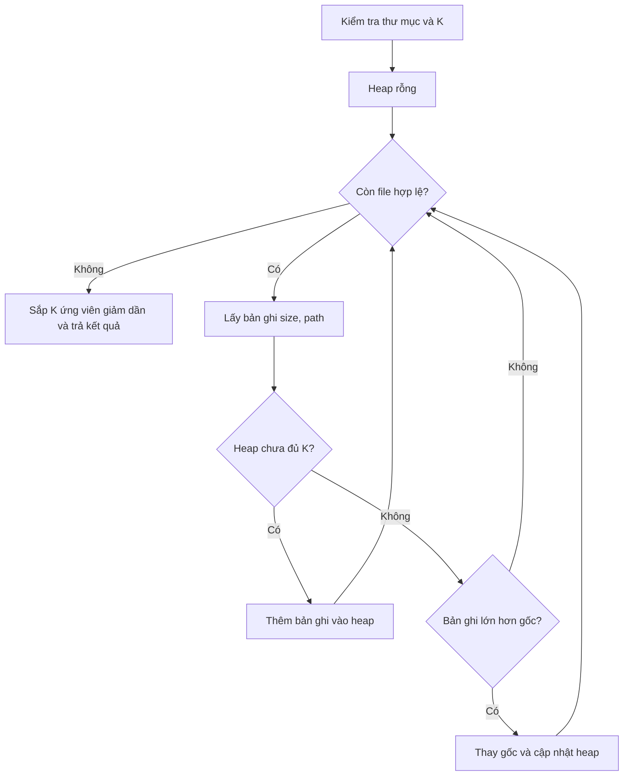
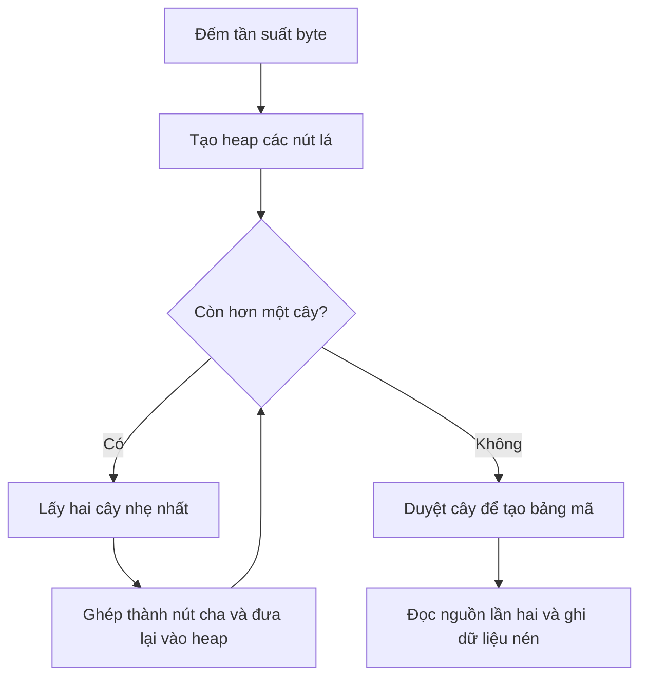

# Báo cáo kỹ thuật Smart File Optimizer

Ứng dụng Python tìm K file lớn nhất trong một thư mục bằng Min-Heap, kèm nén và giải nén Huffman. Đề tài 18, học phần Cấu trúc dữ liệu và Giải thuật.

Ứng dụng chạy cục bộ với giao diện Streamlit và CLI dùng chung phần xử lý. Bản Windows portable đóng gói Python và thư viện đi kèm.

## 1. Bài toán và phạm vi

**Đầu vào:** đường dẫn thư mục và số nguyên dương K. Chương trình duyệt cả thư mục con, lấy kích thước và đường dẫn của từng file thông thường.

**Đầu ra:** tối đa K file lớn nhất theo kích thước giảm dần, có bảng, biểu đồ và xuất CSV. Nếu K lớn hơn số file thì trả tất cả file. Khi bằng kích thước, so sánh đường dẫn giảm dần để kết quả nhất quán.

Huffman là chức năng mở rộng: người dùng chọn một file để nén sang `.huf`, hoặc khôi phục từ `.huf` sang đường dẫn mới. Chương trình giữ nguyên nguồn và từ chối ghi đè đích. Không tự xóa hoặc tự nén các file trong danh sách Top-K. Không hỗ trợ ZIP/RAR hay gom nhiều file thành một archive.

Các thách thức chính:

- Thư mục có nhiều file nhưng người dùng chỉ cần một số ít kết quả: hạn chế lưu toàn bộ danh sách.
- Kích thước bằng nhau và đầu vào không hợp lệ: cần quy tắc xử lý xác định.
- Đọc file có thể gặp lỗi truy cập hoặc file biến mất: tiếp tục quét khi có thể và ghi nhận lỗi.
- Nén phải khôi phục đúng dữ liệu: kiểm tra cấu trúc file nén và SHA-256.

## 2. Chạy chương trình

### Windows portable

Trong [GitHub Actions](https://github.com/CaoXuanThanh/smart-file-optimizer/actions), mở lượt **Build Windows portable** thành công, tải artifact `SmartFileOptimizer-Windows-x64`, giải nén toàn bộ rồi mở `SmartFileOptimizer.exe`. Giữ `.exe` cùng thư mục `_internal`. Giao diện sử dụng địa chỉ `http://127.0.0.1:8501` trên máy chạy ứng dụng.

### Chạy từ mã nguồn trên Windows

Mở terminal trong thư mục có `app.py`. Dùng Python đã cài để tạo môi trường riêng:

```powershell
py -m venv .venv
.\.venv\Scripts\python.exe -m pip install -r requirements.txt
.\.venv\Scripts\python.exe scripts/make_demo.py
.\.venv\Scripts\python.exe -m streamlit run app.py --server.address 127.0.0.1
```

CI hiện cấu hình Python 3.11 và 3.12. Máy Windows của người trình bày đã chạy giao diện với Python 3.14.2; đây là thử nghiệm thủ công, không phải thêm một cấu hình vào ma trận CI.

Trên Linux/macOS: tạo môi trường bằng `python3 -m venv .venv` và thay đường dẫn Python trong lệnh bằng `.venv/bin/python`.

### Dòng lệnh

Các lệnh sau dùng Python đang cài trên máy; có thể thay `python` bằng đường dẫn Python trong `.venv`. CLI chỉ cần thư viện chuẩn.

```shell
python scripts/make_demo.py
python cli.py scan demo_data -k 3 --json
python cli.py scan demo_data -k 3 --csv top_k.csv
python cli.py compress demo_data/notes.txt demo_data/notes.huf
python cli.py decompress demo_data/notes.huf demo_data/restored.txt
python cli.py verify demo_data/notes.txt demo_data/restored.txt
```

File đầu ra phải chưa tồn tại. Khi chạy lại, dùng tên đích mới và sửa đường dẫn trong lệnh verify cho khớp. Verify trả mã thoát 0 khi hash khớp, 2 khi khác; lỗi thao tác trả 1.

## 3. Cấu trúc dữ liệu và lựa chọn giải pháp

| Thành phần | Cách biểu diễn trong code | Mục đích |
|---|---|---|
| Một file | Tuple `(size, path)` | So sánh kích thước, dùng đường dẫn làm tiêu chí phụ |
| Top-K | List chứa tối đa K tuple, thao tác qua `heapq` | Gốc là ứng viên nhỏ nhất đang giữ |
| Tần suất byte | `Counter`, tối đa 256 khóa | Đếm số lần xuất hiện của byte |
| Cây Huffman | Lá là số nguyên byte; nút trong là tuple `(left, right)` | Biểu diễn mã tiền tố nhị phân |
| Hàng đợi dựng cây | Tuple `(frequency, serial, node)` trong heap | Lấy hai cây nhẹ nhất; `serial` xử lý đồng tần suất |
| Bảng mã | Dictionary từ byte sang mã bit | Tra mã nhanh khi nén |

Chương trình sử dụng `heapq` cho thao tác heap. Logic giới hạn K, quy tắc thay ứng viên, dựng cây và mã Huffman được tổ chức trong mã nguồn dự án. Không tuyên bố tự cài đặt mọi phép heap từ đầu.

### Vì sao chọn Min-Heap?

| Phương án | Thời gian khâu chọn và trả kết quả | Bộ nhớ lưu ứng viên | Đánh giá |
|---|---|---|---|
| Sắp xếp toàn bộ | O(N log N) | O(N) | Dễ cài đặt, dùng làm phương án đối chiếu |
| Min-Heap giới hạn K | O(N log K) + O(K log K), với K ≥ 2 | O(K) | Phù hợp khi chỉ cần K nhỏ so với N |
| Max-Heap của toàn bộ N file | O(N) dựng heap và O(K log N) lấy kết quả | O(N) | Có thể lấy lớn nhất nhanh nhưng phải giữ toàn bộ N phần tử |

Với K = 1, khâu chọn là O(N). Nếu K > N, heap chỉ giữ N phần tử. O(K) là giới hạn của phần lựa chọn, không phải tổng RAM của ứng dụng; `os.walk` còn giữ danh sách tên trong từng thư mục, ứng dụng còn lưu lỗi và dữ liệu giao diện. Phân tích trên xem phép so sánh bản ghi là thao tác đơn vị; so sánh đường dẫn khi kích thước bằng nhau có chi phí phụ thuộc độ dài chuỗi.

### Lưu đồ chọn Top-K



Đầu vào sai thì báo lỗi. Scanner bỏ qua symlink, ghi nhận lỗi truy cập có thể bắt được và đưa các file đọc được vào khâu chọn. Phép “lớn hơn” trong lưu đồ so sánh tuple `(size, path)`, không chỉ riêng kích thước.

**Tính đúng:** sau mỗi bước, heap giữ `min(K, số file đã xét)` bản ghi lớn nhất đã gặp. Khi chưa đủ K, thêm bản ghi mới. Khi đủ K, bản ghi không hơn gốc không thể cải thiện tập kết quả; bản ghi lớn hơn gốc thay thế ứng viên nhỏ nhất. Bất biến được duy trì đến cuối, sau đó chỉ cần sắp thứ tự hiển thị.

### Huffman

Đếm tần suất byte, liên tục ghép hai cây có tổng tần suất nhỏ nhất, rồi duyệt cây để sinh mã bit. Quy tắc dựng cây xác định giúp giải nén dựng lại cùng cây từ bảng tần suất trong file.



File rỗng dùng nhánh riêng, không dựng cây có lá. File có một loại byte dùng mã `0`. Khi giải nén, chương trình đọc header, dựng lại cây, khôi phục byte và kiểm tra tính toàn vẹn. HUF2 lưu SHA-256; HUF1 cũ không có checksum.

Huffman phù hợp để minh họa cây nhị phân, hàng đợi ưu tiên và mã tiền tố. Nén đọc nguồn hai lượt, xử lý theo khối 64 KiB. Hiệu quả nén phụ thuộc phân bố byte và chi phí header. Xem [định dạng HUF](FORMAT.md).

## 4. Kiểm thử và minh chứng

```shell
python -m unittest discover -s tests -v
```

Lần rà ngày **04/11/2026** chạy đủ **28 test, không lỗi, không bỏ qua** trên môi trường Linux kiểm tra. [Log đầy đủ](test_results_latest.txt) và [kết quả từng test](test_results_latest.json) ghi phiên bản Python và môi trường thực tế. Đây là kết quả test chương trình, không phải phép benchmark mới.

| Đầu vào / tình huống | Kết quả mong đợi | Quan sát trong lần chạy | Test |
|---|---|---|---|
| 4 file có kích thước 4, 9, 12, 2 byte; K=2 | Trả kích thước 12, 9; quét đủ 4 | Khớp, không lỗi quét | `test_topk` |
| Thư mục rỗng; K=3 | Danh sách kết quả rỗng | Khớp | `test_empty` |
| K=0, -1, 1.5, True hoặc chuỗi | Từ chối K không hợp lệ | Phát sinh `ValueError` đúng yêu cầu | `test_invalid_k` |
| Hai file a và b cùng 700 byte; K=10 | Trả cả hai, b trước a theo đường dẫn | Khớp thứ tự và số lượng | `test_k_above_n_and_ties` |
| Bản ghi ngẫu nhiên, N đến 10.000, nhiều giá trị K | Giống `sorted(..., reverse=True)[:K]` | Khớp toàn bộ kết quả đối chiếu | `test_random_top_k_oracle` |
| File rỗng, một ký hiệu, văn bản và nhị phân | Nén rồi giải nén trùng byte và SHA-256 | Khớp ở mọi mẫu trong test | `test_roundtrip` |
| Nhị phân ngẫu nhiên 1 MiB | Khôi phục hash trùng nguồn | Khớp, kiểm tra toàn vẹn thành công | `test_multichunk_roundtrip` |
| Đích đã có nội dung KEEP | Báo lỗi và giữ nguyên KEEP | Không ghi đè | `test_existing_destination_preserved` |
| File nén cắt ngắn hoặc dữ liệu bị đổi | Báo lỗi, không để lại đầu ra lỗi | Đạt các kiểm tra trong test | `test_truncated_archives`, `test_checksum_corruption_cleanup` |
| Đầu ra vượt giới hạn cho phép | Từ chối giải nén | Báo lỗi trước khi tạo kết quả | `test_output_limit` |
| Byte phân bố đều | Cho phép file nén lớn hơn nguồn | Tỷ lệ tiết kiệm âm như dự kiến | `test_incompressible_expands` |

Có thêm hai test tích hợp dashboard qua AppTest. Test lỗi quyền truy cập dùng giả lập có kiểm soát; không trình bày nó như sự cố quyền đã xảy ra trên máy Windows. Test symlink có thể bỏ qua trên máy không cho phép tạo symlink; lần chạy ghi ở trên không có test bị bỏ qua.

**Windows và CI:** ảnh kết quả cung cấp ngày 01/11/2026 xác nhận `Python checks #2` và `Build Windows portable #3` thành công ở commit `2ffec51`. Workflow kiểm tra Python cấu hình Windows/Linux với Python 3.11/3.12. Workflow portable kiểm tra EXE khởi động và trả health check. Đây là bằng chứng CI của commit đó, không phải kiểm thử mọi chức năng trên mọi máy Windows.

## 5. Thực nghiệm hiệu năng

Kết quả dưới đây là lần đo ngày 30/10/2026, giữ nguyên dữ liệu gốc. Môi trường: Linux x86_64, Python 3.12.14. Seed 18, warmup, trung vị 5 lần đo. Đo thời gian khi không bật tracemalloc; đo bộ nhớ ở lượt riêng. Bộ nhớ là cấp phát Python, không phải tổng RAM tiến trình.

| Dữ liệu, K=10 | Min-Heap: ms | Sort: ms | Min-Heap: KiB | Sort: KiB |
|---|---:|---:|---:|---:|
| 50.000 bản ghi tổng hợp | 32,09 | 56,71 | 5,47 | 8.539,90 |
| Thư mục 10.000 file thực | 138,89 | 138,32 | 422,70 | 1.840,34 |

Với bản ghi tổng hợp, heap dùng ít bộ nhớ hơn và có thời gian thấp hơn trong lần đo này. Khi tính cả truy cập file, thời gian gần tương đương, trong khi bộ nhớ vẫn thấp hơn. Không kết luận heap luôn nhanh hơn sort.

Bộ tổng hợp còn có N=10.000, 25.000 và 50.000; K=10, 100 và 1.000. Phép đo này gồm chi phí sinh bản ghi nhưng không gồm truy cập ổ đĩa. Phép đo 10.000 file thực có cache hệ thống và tạo fixture ngoài thời gian đo.

Mẫu demo `notes.txt`: **576.000 B** thành **304.762 B**, giảm **47,09%**. Mẫu văn bản lặp trong benchmark codec là một bộ khác: **600.000 B** thành **317.735 B**, giảm **47,04%**. Không trộn hai mẫu này khi trình bày.

- [Phương pháp và bảng kết quả đầy đủ](VALIDATION.md)
- [Số liệu từng lượt](../benchmarks/raw.csv), [tổng hợp](../benchmarks/summary.json)
- [Kết quả quét file thực và codec](../benchmarks/disk_and_codec.json)
- [Môi trường đo](../benchmarks/environment.json)

Chạy lại khi cần tái lập bằng `python benchmarks/run.py` và `python benchmarks/disk_and_codec.py`. Các script ghi lại file kết quả trong thư mục benchmarks, nên lưu bản số liệu cũ trước khi chạy. Số đo có thể thay đổi theo môi trường.

## 6. Tài liệu tham khảo và cách sử dụng

Các nguồn sau được đối chiếu khi hoàn thiện hồ sơ ngày 04/11/2026. Ưu tiên tài liệu chính thức và tài liệu giảng dạy có mô tả thuật toán để kiểm tra được cách áp dụng.

| Nguồn | Vấn đề cần giải quyết | Áp dụng trong dự án |
|---|---|---|
| [Python 3.12: heapq](https://docs.python.org/3.12/library/heapq.html) | Duy trì ứng viên nhỏ nhất ở gốc | Dùng `heappush`, `heapreplace`, `heappop`; kết hợp logic Top-K trong core.py |
| [Stanford CS106B: Huffman coding](https://web.stanford.edu/class/archive/cs/cs106b/cs106b.1206/assignments/assign7/huffman) | Tổ chức cây mã và hàng đợi ưu tiên | Đối chiếu nguyên lý dựng cây và kiểm thử nén–giải nén; dự án có định dạng HUF2 riêng |
| [Python: tracemalloc](https://docs.python.org/3/library/tracemalloc.html) | Đo lượng bộ nhớ Python cấp phát | Đo peak riêng với thời gian, tránh gọi kết quả là tổng RAM |
| [Python 3.12: hashlib](https://docs.python.org/3.12/library/hashlib.html) | Đối chiếu dữ liệu sau khôi phục | Tính SHA-256 theo khối, dùng trong verify và HUF2 |
| [Streamlit: AppTest](https://docs.streamlit.io/develop/api-reference/app-testing/st.testing.v1.apptest) | Kiểm thử trạng thái giao diện | Kiểm tra quét file, lỗi và nén/giải nén trong tests/test_ui.py |

Tài liệu giải thích cơ sở lựa chọn. Hiệu quả của giải pháp được đánh giá bằng dữ liệu thực nghiệm của dự án, không suy ra chỉ từ tài liệu tham khảo. Lưu đồ và phân tích Top-K ở trên mô tả bản cài đặt trong repo.

## 7. Tổ chức mã nguồn

| Đường dẫn | Khi sử dụng |
|---|---|
| `app.py` | Chạy giao diện trình duyệt |
| `cli.py` | Chạy lệnh scan, compress, decompress, verify |
| `launcher.py` | Điểm khởi động cho bản EXE |
| `src/smartfile/` | Thuật toán và xử lý file dùng chung |
| `scripts/make_demo.py` | Tạo dữ liệu mẫu trước khi demo |
| `tests/` | Chạy kiểm thử tự động |
| `benchmarks/` | Đo hiệu năng và lưu số liệu thực nghiệm |
| `.github/workflows/` | GitHub Actions đọc để chạy kiểm thử, đóng gói |
| `docs/` | Hướng dẫn, minh chứng và tài liệu kỹ thuật |


## 8. Giới hạn

Nguồn phải ổn định trong lúc nén. File đầu ra xuất hiện khi đang ghi; dừng tiến trình cưỡng bức có thể để lại file dở. Chưa có tiến độ/hủy tác vụ cho file lớn. Mặc định giới hạn giải nén 1 GiB. SHA-256 giúp kiểm tra toàn vẹn, không cung cấp mã hóa bảo mật hay chữ ký. Dashboard bind localhost và truy cập file của máy chạy chương trình.

Hướng dẫn cập nhật mã nguồn nằm trong [Quy trình Git và commit](GITHUB.md).

Mã nguồn dùng giấy phép MIT trong [LICENSE](../LICENSE). Giấy phép quy định quyền sử dụng mã, không phải chứng nhận chất lượng sản phẩm.
